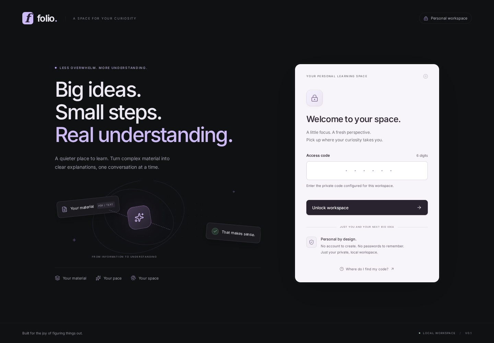
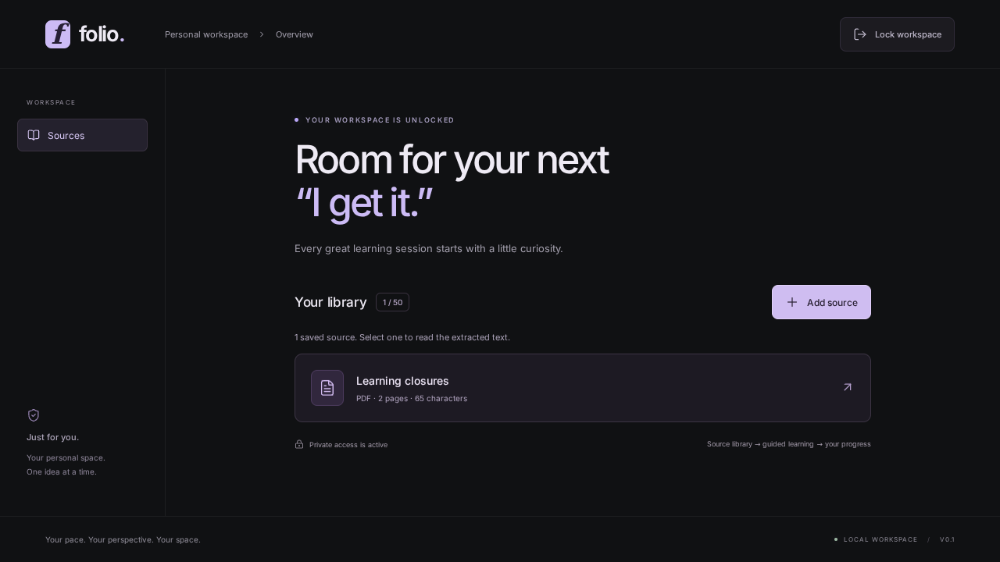
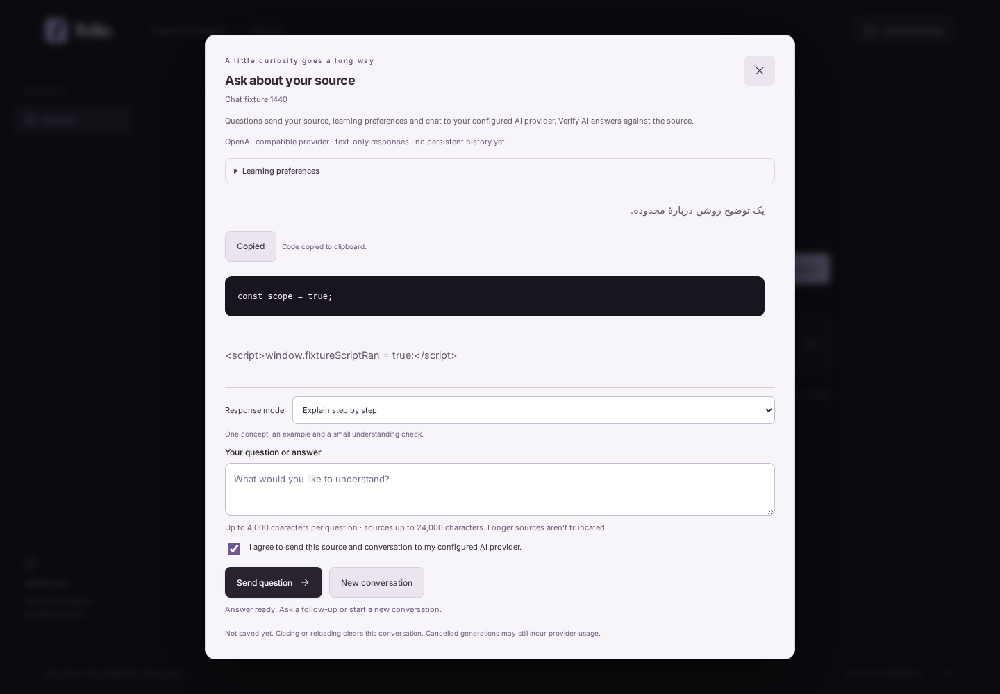
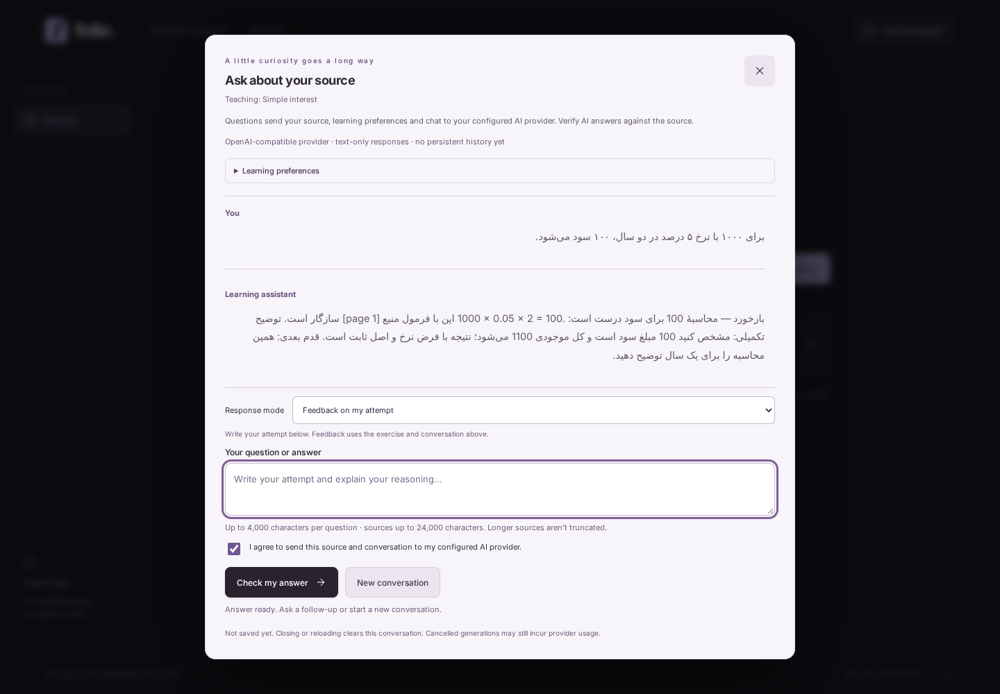
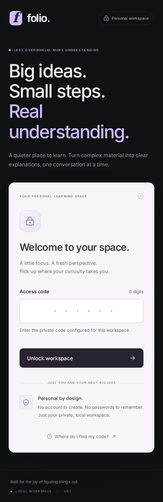
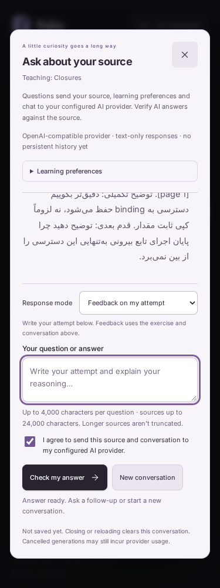

# تصاویر واقعی رابط Folio 💜

این تصاویر از نسخهٔ فعلی برنامه در مرورگر گرفته شده‌اند؛ طرح فرضی یا تصویرسازی نیستند. برای دیدنشان به کلید هوش مصنوعی نیازی نیست.

> **توجه:** پاسخ‌های بخش گفت‌وگو و آموزش، داده‌های نمونهٔ کنترل‌شدهٔ تست‌اند؛ خروجی زندهٔ Gemini نیستند. نوشته‌های HTML و script در بعضی تصاویر عمداً برای بررسی نمایش امن متن استفاده شده‌اند و اجرا نمی‌شوند. هیچ کلید واقعی یا دادهٔ شخصی در تصاویر وجود ندارد.

## صفحهٔ ورود — دسکتاپ

## کتابخانهٔ منابع — دسکتاپ

## گفت‌وگوی فارسی و کد — دسکتاپ

## آموزش و بازخورد — دسکتاپ

## نسخهٔ موبایل

### ورود

### آموزش برنامه‌نویسی

## تمام تصاویر

نسخه‌های واکنش‌گرا در عرض‌های **۳۷۵ موبایل، ۷۶۸ تبلت و ۱۴۴۰ دسکتاپ** ثبت شده‌اند. تصویر کتابخانه با نام `source-library-1440.png` نامِ خروجی تست را حفظ کرده است، اما عرض واقعی آن ۱۲۸۰ پیکسل است.

| بخش | موبایل | تبلت | دسکتاپ |
| --- | --- | --- | --- |
| ورود | [تصویر](login-375.png) | [تصویر](login-768.png) | [تصویر](login-1440.png) |
| فضای شخصی | [تصویر](workspace-375.png) | [تصویر](workspace-768.png) | [تصویر](workspace-1440.png) |
| مشاهدهٔ متن منبع | [تصویر](source-preview-375.png) | [تصویر](source-preview-768.png) | [تصویر](source-preview-1440.png) |
| گفت‌وگو | [تصویر](chat-375.png) | [تصویر](chat-768.png) | [تصویر](chat-1440.png) |

- [کتابخانهٔ منابع](source-library-1440.png)
- [آموزش closure در موبایل](teaching-Closures.png)
- [آموزش سود ساده در دسکتاپ](teaching-Simple-interest.png)

تصاویر در ۲۰۲۶-۱۰-۲۳ با اجرای مجدد تست‌های مرورگر گرفته شدند؛ هر ۱۶ تست موفق بود. این پوشه عمداً برای مشاهده در GitHub در Git نگه‌داری می‌شود؛ پوشهٔ موقت `screenshots/` همچنان نادیده گرفته می‌شود.
